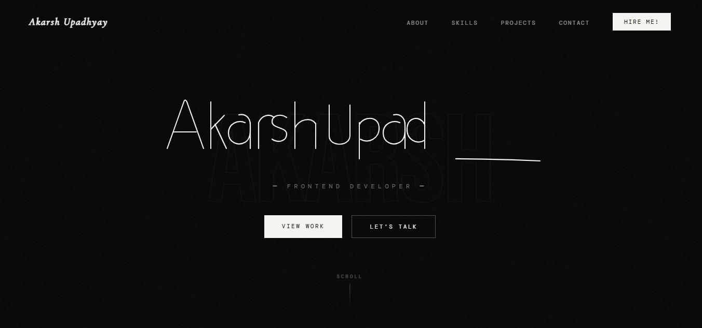
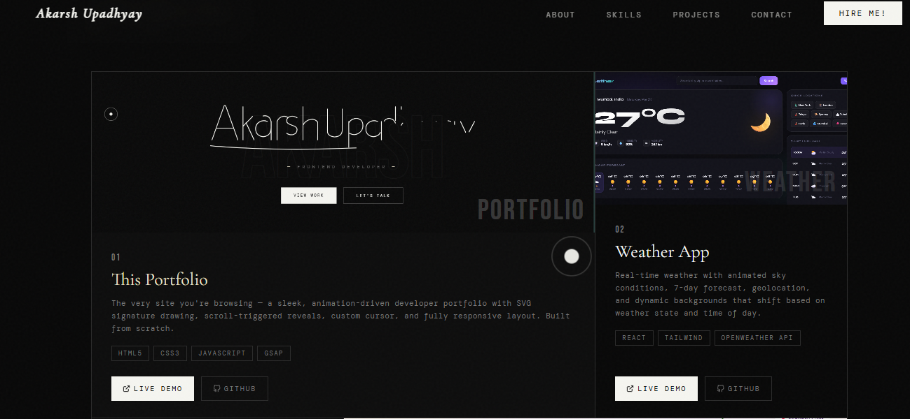
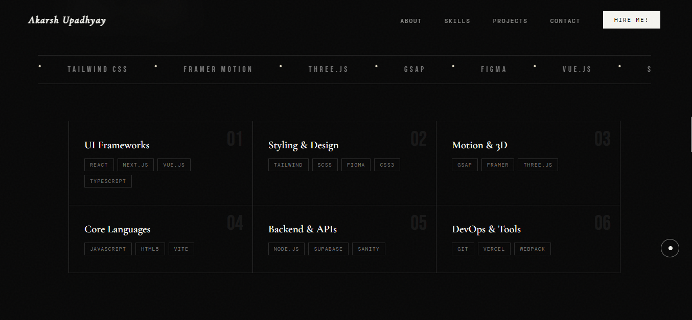
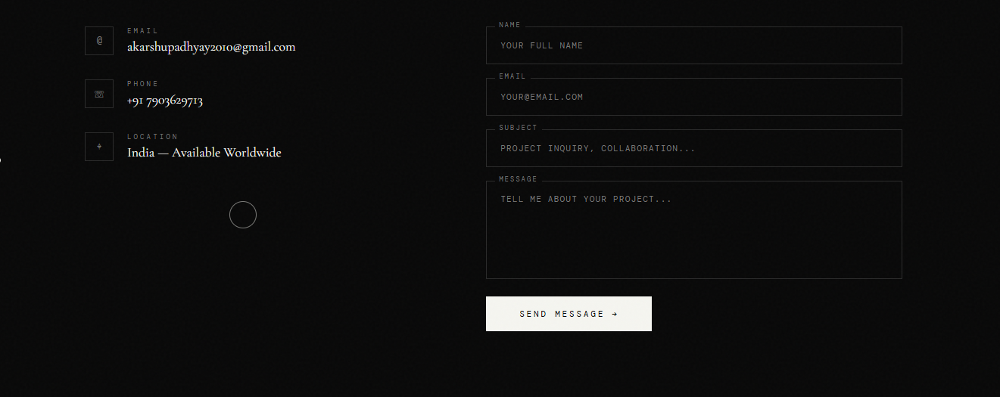

# Akarsh Upadhyay — Portfolio






---

## 📁 Project Structure

```
portfolio/
├── portfolio.html              # Main portfolio file
├── README.md                   # This file
│
├── weather.png                 # Weather app screenshot
│
└── focusflow/                  # FocusFlow screenshots
    ├── Create_focusflow.jpg
    ├── Entering_focusflow.jpg
    ├── Homescreen_focusflow.jpg
    ├── Settings_focusflow.jpg
    ├── Signin_focusflow.jpg
    ├── Stats_focusflow.jpg
    ├── Task_focusflow.jpg
    └── Welcome_focusflow.jpg
```

---

## ✨ Features

- SVG signature draw → erase → redraw animation
- Custom cursor with smooth ring follow
- Scroll-triggered fade-up reveal animations
- Horizontal marquee tech stack ticker
- Project grid with color-coded thumbnails
- Tech logo hover effects on skill pills
- FocusFlow filmstrip screenshot carousel
- Web3Forms contact form with success/error states
- Noise grain texture overlay
- Fully responsive (mobile + desktop)

---

## 🚀 Deploying to GitHub Pages

### Step 1 — Create a GitHub account
Go to [github.com](https://github.com) and sign up if you don't have an account.

---

### Step 2 — Install Git
Download and install Git from [git-scm.com](https://git-scm.com/downloads).

Verify it's installed by opening your terminal and running:
```bash
git --version
```

---

### Step 3 — Configure Git (first time only)
```bash
git config --global user.name "Akarsh Upadhyay"
git config --global user.email "your@email.com"
```

---

### Step 4 — Create a new repo on GitHub
1. Go to [github.com/new](https://github.com/new)
2. Name it exactly: `akarsh-portfolio` (or `yourusername.github.io` for a root domain)
3. Set it to **Public**
4. Do **NOT** tick "Add a README" — we'll push our own
5. Click **Create repository**

---

### Step 5 — Set up your local project folder
Open your terminal, navigate to your portfolio folder:
```bash
cd path/to/your/portfolio-folder
```

For example on Windows:
```bash
cd C:\Users\Akarsh\Desktop\portfolio
```

---

### Step 6 — Initialize Git and push
Run these commands **one by one**:

```bash
# 1. Initialize a git repo in your folder
git init

# 2. Add all your files
git add .

# 3. Make your first commit
git commit -m "Initial commit — portfolio"

# 4. Connect to your GitHub repo (replace YOUR_USERNAME)
git remote add origin https://github.com/YOUR_USERNAME/portfolio.git

# 5. Rename branch to main
git branch -M main

# 6. Push to GitHub
git push -u origin main
```

---

### Step 7 — Enable GitHub Pages
1. Go to your repo on GitHub
2. Click **Settings** tab
3. Scroll down to **Pages** in the left sidebar
4. Under **Source**, select `main` branch and `/ (root)` folder
5. Click **Save**
6. Wait ~60 seconds, then visit:

```
https://YOUR_USERNAME.github.io/akarsh-portfolio/
```

🎉 Your portfolio is live!

---

## 🔄 Updating the Portfolio Later

Every time you make changes to your files, run:

```bash
# Add changed files
git add .

# Commit with a message describing your changes
git commit -m "Updated project links and contact info"

# Push to GitHub
git push
```

GitHub Pages will auto-update within ~30 seconds.

---

## 📬 Contact Form Setup (Web3Forms)

1. Go to [web3forms.com](https://web3forms.com)
2. Enter your email → get your free access key
3. Open `portfolio.html` and find:
   ```html
   <input type="hidden" name="access_key" value="YOUR_ACCESS_KEY_HERE"/>
   ```
4. Replace `YOUR_ACCESS_KEY_HERE` with your actual key
5. Save and push again

---

## 🛠 Customisation Checklist

- [ ] Replace `YOUR_ACCESS_KEY_HERE` with Web3Forms key
- [ ] Update email in contact section
- [ ] Update phone number
- [ ] Add your photo (replace "Your Photo Here" placeholder)
- [ ] Add `weather.png` screenshot
- [ ] Add all 8 FocusFlow screenshots
- [ ] Update project Live Demo links (`href="#"`)
- [ ] Update project GitHub links (`href="#"`)
- [ ] Update social links in footer (GitHub, LinkedIn, Twitter, Dribbble)

---

## 📄 License

Built by **Akarsh Upadhyay**. Feel free to use as inspiration — just don't copy it wholesale. ✌️